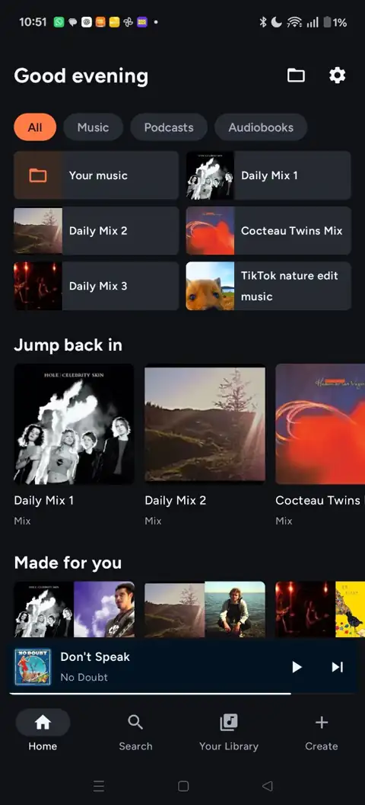
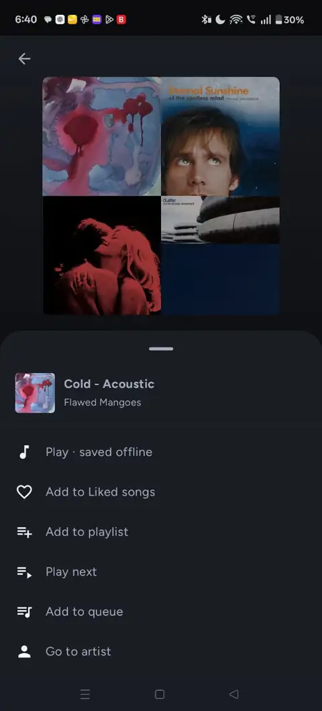
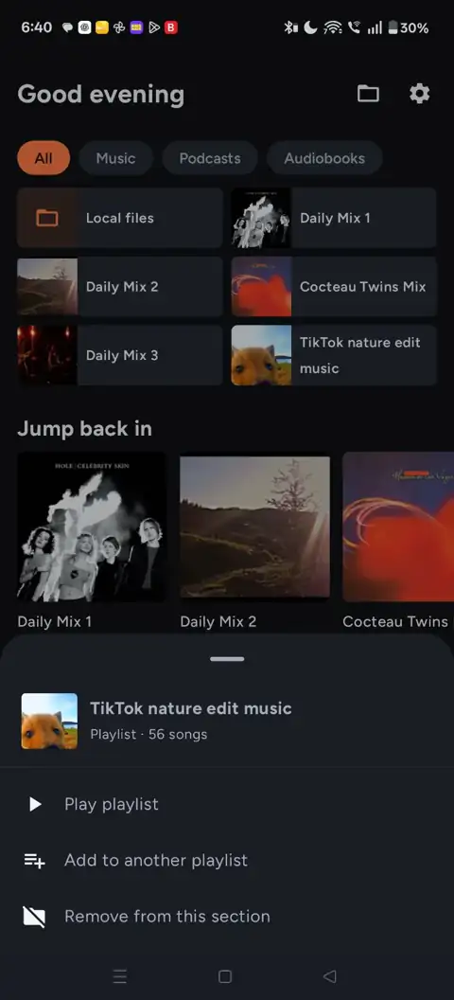

# Groovio

**Discover music. Build your playlists. Listen anywhere.**

A free, open-source Android music player with a dark interface, coral accents and a library that's yours.

**Release clarity:** [v0.1.71](https://github.com/billyke2000s/Groovio/releases/tag/v0.1.71) is the last owner-confirmed song-playback build. **Features described below reflect newer experimental source and may not be in the stable APK or phone-verified.** See the [current source and verification index](docs/CURRENT_STATE.md).

[**Download APK**](https://github.com/billyke2000s/Groovio/releases) · [**Latest stable**](https://github.com/billyke2000s/Groovio/releases/latest) · [**Source code**](https://github.com/billyke2000s/Groovio)

  

## Your home for music

Pick up where you left off with **Jump back in**, find a favourite playlist in seconds, or explore your **Daily Mixes**. The mini-player stays close while you browse.

### Search and discover

Look for songs, artists and albums, explore recommendations, and open collections to browse their tracks. **Last Groove** helps you return to music you've recently enjoyed.

### Playlists and your library

Create playlists, save favourites and organise your collections in **Your Library**. Long-press a song or playlist for quick actions like adding to a playlist, playing next or downloading music.

  
  &nbsp;
  

### Your music, even offline

Keep your downloads and imported audio together in **Your music**. Browse saved songs, play everything, shuffle or add music from your phone. Private completed downloads are the offline playback source; optional public copies in **Music/Groovio** are separate files on Android 10+. Some Home collections may still contain undownloaded tracks while offline.

### A player that stays out of your way

Enjoy large album artwork, a mini-player and full playback controls. Swipe to skip tracks, manage the queue, shuffle, repeat and set a sleep timer.

### Make it sound right

Use the five-band equaliser, choose a preset or enable optional volume normalisation. Audio-effect availability depends on your Android device.

### Podcasts and audiobooks

Discover available episodes and recordings, save them to your library and resume where you left off. Direct links to individual saved items from every Library entry, automatic episode refresh and timestamp chapters are not finished.

---

## Get Groovio

**Android 8.0 or newer** is required.

1. Open the [releases page](https://github.com/billyke2000s/Groovio/releases) and choose an APK.
2. Open the downloaded file and allow installation from that source if Android asks.
3. Launch Groovio and start listening.

**Updating?** Install a newer signed APK over your existing app rather than uninstalling first. Use **Settings → Back up library** before testing new builds. In newer experimental code, Android 10+ also gets a pre-install JSON snapshot; Android 8/9 needs manual backup. Backups **exclude downloaded audio and individual song-play history**; repeating restore creates extra playlists.

[**Releases**](https://github.com/billyke2000s/Groovio/releases) · [**Experimental builds**](https://github.com/billyke2000s/Groovio/releases?q=experimental-v) · [**Build from source**](CONTRIBUTING.md)

## How it works

Groovio plays available YouTube / YouTube Music audio through on-device extraction. Spotify links are used to match track and playlist **metadata** to available audio; they don't stream Spotify's protected catalogue. Not every track is guaranteed to match or play in every region.

Your playlists, favourites and settings are stored locally. Groovio doesn't require a Groovio account, subscription or hosted music server.

<strong>Technical details and development</strong>

Groovio is written in **Kotlin** with **Jetpack Compose**. Playback uses **AndroidX Media3**, the local library uses **Room**, background downloads use **WorkManager**, and artwork uses **Coil**. Audio extraction uses [NewPipe Extractor](https://github.com/TeamNewPipe/NewPipeExtractor), with optional artist metadata from [MusicBrainz](https://musicbrainz.org/).

The project is actively developed. Some features still need testing across different Android devices, audio outputs and network conditions. See [current verified/unverified state](docs/CURRENT_STATE.md), [development history](docs/EXPERIMENTAL_STATUS.md) and [contributing](CONTRIBUTING.md).

Groovio isn't affiliated with YouTube, YouTube Music or Spotify.

---

**Made for the music you love.**

[Contribute](CONTRIBUTING.md) · [GPL-3.0 licence](LICENSE)

